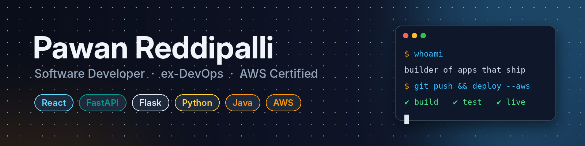

**Software developer with a DevOps background · AWS Certified Solutions Architect.** I build full-stack apps with **React** and **Python (Flask / FastAPI)**, and because I came from DevOps, I also handle the part many developers skip: deploying, automating, and running what I build on **AWS**.

- 💻 **Now:** software developer building web apps and APIs
- 🔁 **Before:** DevOps engineer working on infrastructure, automation, and CI/CD
- 🌱 **Learning:** Kubernetes and Rust
- 📫 **Reach me:** [LinkedIn](https://www.linkedin.com/in/pawan-reddipalli-733408181/)

## 🏅 Certifications

- **AWS Certified Solutions Architect – Associate**
- **AWS Certified Cloud Practitioner**

## 🛠 Tech stack

**Frontend:** React · JavaScript · HTML/CSS
**Backend:** Python · FastAPI · Flask · Java (Spring Boot)
**Databases:** PostgreSQL · MySQL
**Cloud & DevOps:** AWS · Terraform · Ansible · Linux · CI/CD

## 🚀 Featured projects

| Project | What it is | Stack |
|---|---|---|
| [Task_Master](https://github.com/pawan-reddipalli/Task_Master) | Task manager web app with full CRUD | Python, Flask, MySQL |
| [User-Authentication-SpringBoot](https://github.com/pawan-reddipalli/User-Authentication-SpringBoot) | User registration, encrypted passwords, role-based access | Java, Spring Boot, PostgreSQL |
| [Terraform-learn](https://github.com/pawan-reddipalli/Terraform-learn) | Labs that provision AWS infrastructure as code | Terraform, AWS |
| [Basic-Weather-App](https://github.com/pawan-reddipalli/Basic-Weather-App) | Live weather for any city via the OpenWeather API | JavaScript, HTML, CSS |

---

DevOps → Software Development · open to full-stack and backend roles
